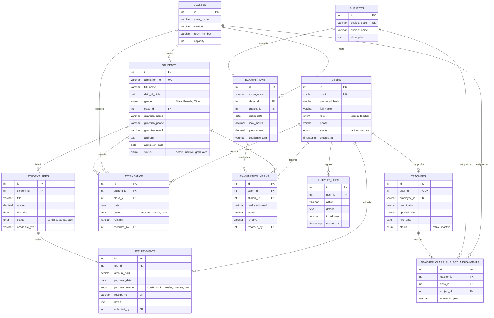

# Entity Relationship Diagram (ERD)
## EduPulse - School Management System

This document outlines the normalized relational database architecture for the School Management System implemented in MySQL 8.0.

### 1. Mermaid Entity-Relationship Diagram

---

### 2. Normalization Verification
- **1NF (First Normal Form)**: All column values are atomic. No multi-valued sets or comma-separated lists of classes or subjects in single columns.
- **2NF (Second Normal Form)**: Every non-key attribute is fully functionally dependent on the entire primary key. Junction tables (`teacher_class_subject_assignments`, `examination_marks`) separate compound associations.
- **3NF (Third Normal Form)**: Non-key attributes depend only on the primary key, eliminating transitive dependencies. For example, student details are not duplicated inside fee payment records; instead, `fee_payments` references `student_fees` which references `students`.
